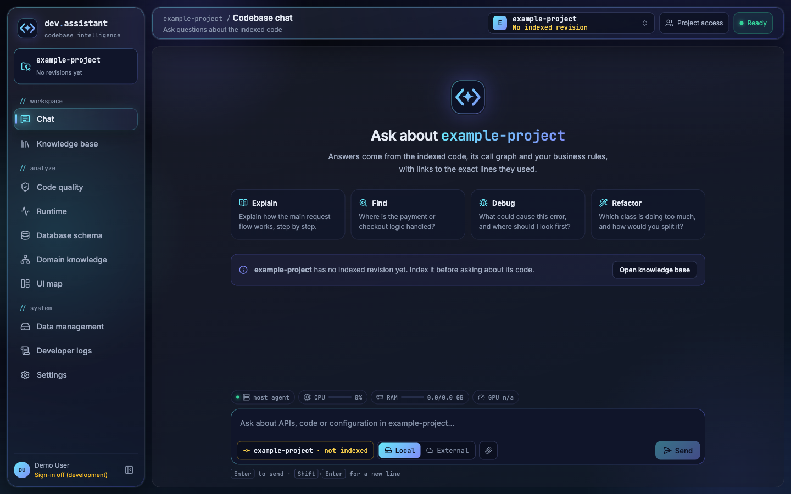
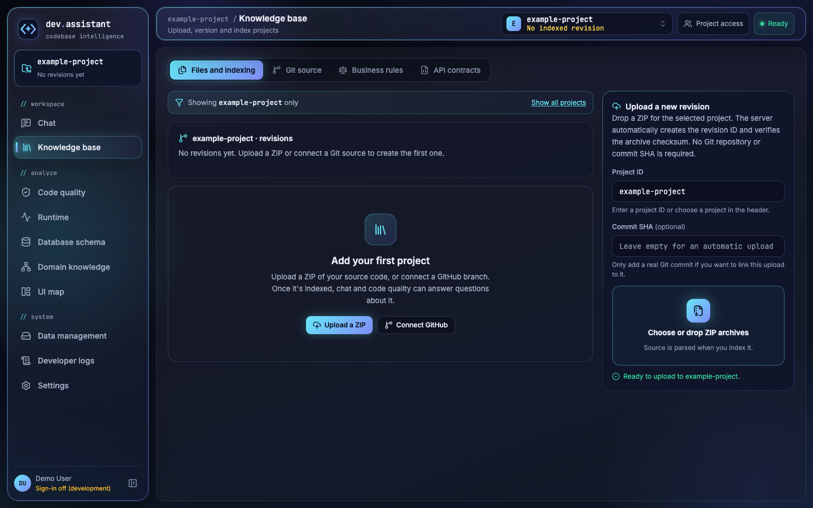

<p align="center">
  
</p>

# Developer Intelligence Assistant

A developer assistant for exploring source code, assessing code quality, and investigating runtime
behavior. Upload a project, index its code, and ask questions in natural language. The application
retrieves relevant context and uses a locally configured language model to help answer.

## Topics

- [Screenshots](#screenshots)
- [Installation and first use](#installation-and-first-use)
- [Features](#features-implemented)
- [Code Quality and analyzers](#code-quality-assessment)
- [Runtime telemetry and PHP packages](#runtime-telemetry)
- [Architecture](#architecture)
- [Configuration](#configuration)
- [Known limitations](#known-limitations--next-steps)

## Screenshots

The examples below show the frontend with a fictional project and simulated service responses.

**Codebase chat**



**Knowledge base**



## Installation and first use

The local installer supports macOS and Ubuntu/Debian. It requires Docker, Ollama, and other host
tools; allow at least 40 GiB of free disk space, four Docker CPUs, and 8 GiB of Docker memory
(16 GiB for analyzers). See the [installation guide](docs/installation.md) for the complete
requirements, supported versions, configuration, credentials, and recovery instructions.

### AI-assisted installation

Give your AI agent the [installation skill](agent/skills/install-developer-assistant/SKILL.md) and ask it
to install Developer Intelligence Assistant. The agent can download the project, check prerequisites,
guide configuration and verification, and help set up Laravel, Symfony, or standalone PHP telemetry.
It will ask for your installation location and any target PHP project.

### Manual installation

```bash
git clone https://github.com/aminmh/developer-intelligence-assistant.git
cd developer-intelligence-assistant
bash install.sh
```

The installer checks dependencies and asks you to review its proposed setup. When installation
finishes, run `bash install.sh info` to view the local application address and credentials. Sign
in, upload a source project through the app, index a revision, and use chat to ask about its code.
Explore **Code Quality** for source assessments and **Runtime** for configured telemetry.
Keep the generated credentials private.


## What this project does

It's a developer-assistant chat over uploaded source projects. ZIP archives can be parsed on demand
into PHP AST chunks, embedded, and indexed for code questions. Retrieval and generation run in a
Python service; a Node web app provides the chat UI and public API; the Python image also ships a
pure-PHP CLI that performs the AST chunking and project-structure extraction.

## Architecture

- **web** (Node/Express) — public entry point (`/api/query`), chat UI, config UI, file management.
- **python-api** (FastAPI + in-image PHP CLI, internal to the Compose network) — routing, retrieval, and answer generation (LlamaIndex,
  Qdrant, Neo4j, Ollama). Also owns MinIO storage, ZIP uploads, workspace extraction, and the
  pure-PHP CLI tools (`code-parse`, `project-export-structure`).
- **Qdrant** — vector store for code chunks.
- **Neo4j** — property graph of code symbols and `CALLS` edges (used for hybrid retrieval).
- **Ollama** — local models: `gemma3-4b` (LLM) and `BGE-M3` (embeddings).
- **MinIO + tusd** — object storage and resumable uploads.

## Features implemented

### Semantic Router
Routes each query by meaning (not keywords) into one of six intents (`code_explain`, `code_refactor`,
`debug`, `search`, `knowledge`, `chat`). A feedback loop stores corrections in Qdrant so the same or
similar queries route correctly later; uncertain cases fall back to an LLM-based selector.

### Query normalization
A shared normalization step runs on both the route examples and the incoming query: NFKC unicode
normalization, case folding, whitespace/punctuation cleanup, and domain-jargon expansion
(`api/Python-Service/app/config/domain_terms.json`). A typo-correction pass (SymSpell over a
domain-only dictionary) is **disabled by default** behind `ENABLE_TYPO_CORRECTION`.

### Hybrid retrieval (vector + graph)
Code is indexed into Qdrant *and* a Neo4j property graph. Retrieval does a vector search, then
walks the graph to pull callee/caller neighbours of the top hits, merges and reranks. If the graph
is unavailable it degrades to vector-only search.

### Intent & entity extraction
Before answering, an LLM extracts structured intent and entities (file, class, method, error code,
framework) via Instructor + Pydantic (`app/intent.py`), used to filter retrieval and enrich the prompt.

### Answer generation
The final answer is generated in Python (`app/answer.py`) from retrieved code context using the
local LLM. Prompts are logged to `logs/llm-prompts.log`.

### Code validation with language servers (LSP framework)
When the LLM emits code blocks in an answer, the Python service validates them with in-image
language servers over the Language Server Protocol (stdio). The framework is modular and
config-driven:

- `app/lsp/client.py` — generic stdio LSP client (framing, diagnostics settle-wait, auto-restart).
- `app/lsp/base.py` — the `LanguageAdapter` contract + shared helpers (block extraction, repair
  prompt, multi-language validation note).
- `app/lsp/adapters/<lang>.py` — one custom adapter per language (see `php.py` for the reference).
- `app/config/lsps.yml` — declarative per-language server config (`enabled`, `adapter`,
  `fence_tags`, `lsp:{binary, args, language_id, validate_dir, timeout}`); `${VAR:-default}` is
  resolved from the environment.

**PHP** uses **Phpactor** (syntax + worse-reflection diagnostics) with **PHPStan** (static
analysis) integrated. Unresolvable external references (classes/functions from the surrounding
project, which a snippet doesn't contain) are demoted to warnings.

Invalid blocks are fed back to the LLM with the diagnostics to auto-repair (up to
`LSP_MAX_RETRIES`, default 2); truncated/illustrative blocks (`...`) are annotated but not
repaired. The answer gets a compact per-language note, e.g. `> ✅ PHP validation passed — 1
block(s), 1 auto-repaired.` The `/answer` response also carries a structured `code_validation`
field (list of `{language, index, status, errors, warnings}`).

If a language server is unavailable, validation falls back to `bin/lint-php` (php-parser +
`php -l`) for PHP. Toggle the whole feature with `LSP_VALIDATION_ENABLED` (default `true`).

#### Adding a new language LSP
1. Install the language server binary in the image (Dockerfile).
2. Add an entry to `app/config/lsps.yml` (`enabled: true`, `adapter`, `fence_tags`, `lsp{...}`).
3. Create `app/lsp/adapters/<adapter>.py` implementing `LanguageAdapter` — copy `php.py` /
   `app/lsp/base.py` as the template (wrap fragments, map diagnostics + downgrade heuristics,
   optional non-LSP fallback, block extraction).
4. Add a test (see `tests/test_php_adapter.py`, `tests/test_lsp_registry.py`) and rebuild the
   image. Adapter + yml changes are live via the `/app` bind-mount; a **new server binary**
   requires `docker compose build python-api`.

For a guided walkthrough, use the `add-language-lsp` skill.

### Code Quality assessment

Assess a selected project revision with source analysis, semantic evidence, and optional performance
tests. Results show coverage and limitations; optional SonarQube and Joern runs add evidence.
See the [Code Quality guide](docs/code-quality-overview.md) for setup, results, and data handling.

### Analyzer worker and remote SonarQube

Optional SonarQube and Joern analysis runs in an isolated worker. Developer Mode supports a remote
worker over mutual TLS with explicit project consent; SonarQube source upload requires separate consent.
Production Mode uses the deployment-local worker. See the [analyzer and Git source guide](docs/analyzer-worker-and-git-source.md)
for certificates, deployment, Git synchronization, and webhook setup.

### Configurable settings
Settings live in a SQLite store and are editable from the UI without restarting: Ollama base URL,
LLM, embedding, and evaluation judge model dropdowns (populated from pulled Ollama models), Qdrant
connection, temperature, and top-P. The evaluation judge model is configurable independently and is
used only by RAGAS scoring.

### Upload and indexing
ZIP projects are stored in MinIO (via the internal Python service) and indexed on demand through the
chat orchestration flow or the file indexing action. New uploads require a project slug and full
lowercase Git commit SHA-1 or SHA-256. Exact-byte retries are accepted; different bytes for the same
project and commit are rejected. The Knowledge Base shows the stored identity. Older uploads stay
unattributed. Document uploads (PDF/Markdown/text) are not supported — the pipeline is code-archive
only.

The tab shell stores the selected tab in the `tab` query parameter, so a tab URL opens consistently
after refresh and participates in browser back/forward navigation.

Browser API access requires an OIDC sign-in. Configure the issuer, client, callback URI, session
secret and bootstrap administrator subject before starting the web service. The first administrator
can grant project roles (`viewer`, `operator`, `admin`) from the Project access control in the UI.
The Python service has no host-published port; browser calls go through the authenticated web API.

### Runtime telemetry

Runtime shows opted-in containers and sampled requests for an indexed project revision, including
request timing, database activity, method observations, and optional AI analysis. Coverage depends on
sampling and instrumentation; raw SQL, bindings, request bodies, and headers are not returned.
Choose Local, Remote, or Disabled ClickHouse storage in Settings & Connection. See the
[Runtime overview](docs/runtime-telemetry-overview.md) for behavior, setup, and limits.

#### Installing PHP telemetry manually

Install the adapter in your PHP application directory. Both adapters automatically install
`aminmh/developer-assistant-otel-core`, so you do not need to require it separately.

**Laravel** (PHP 8.1+, Illuminate 10–12):

```sh
composer require aminmh/developer-assistant-otel-laravel
```

The Laravel package has been submitted to Packagist, but its first release is still awaiting indexing.
See the [Laravel installation and configuration guide](https://github.com/aminmh/developer-assistant-otel-laravel/blob/main/docs/installation.md) for setup.

**Symfony** (PHP 8.1+, Symfony 6.4 or 7):

```sh
composer require aminmh/developer-assistant-otel-symfony
```

See the [Symfony installation and configuration guide](https://github.com/aminmh/developer-assistant-otel-symfony/blob/main/docs/installation.md) for setup.

**Core** (PHP 8.1+):

For a PHP application without a Laravel or Symfony adapter, install and integrate the core directly:

```sh
composer require aminmh/developer-assistant-otel-core
```

See the [core installation and configuration guide](https://github.com/aminmh/developer-assistant-otel-core/blob/main/docs/installation.md) for setup.

#### Setting up a PHP project in one step

For a Docker Compose PHP project, `just php-otel-setup ../my-php-app` can install telemetry, index
source, update configuration, and restart services after showing a plan. It can also commit Composer
files and upload the committed source. The current script uses the local `indexr-otel-library` package
names; check its `--help` and package source before selecting a published package. See the
[one-step setup guide](docs/runtime-telemetry-overview.md#setting-up-a-php-project-in-one-step)
for requirements, effects, and recovery.

### Misc
Feedback button in chat, step-by-step progress while a query runs, session-scoped skip of
re-indexing, exception logging to `logs/exceptions.log`, and a shared inset dropdown chevron on
single-select controls.

## Documentation rule

Every new feature and every bug fix must update this README in the same change. Describe the
user-visible behavior and, when relevant, its setup, configuration, and limitations. Treat the
README update as part of completing the feature or fix.

## Prompt lifecycle

What happens to a prompt from the moment you hit send, using
*"Explain the `planWeekly` method in `BookingSchedulePlanningService`"* (with `Archive.zip` attached):

1. **Normalize** — the raw text is normalized for routing (NFKC → lowercase → cleanup → jargon expansion):
   `explain the planweekly method in bookingscheduleplanningservice`
2. **Classify** — `/classify` (Semantic Router) returns a route, e.g. `code_explain`.
3. **Extract** — `/extract` (Instructor) returns structured entities:
   `{intent: "explain", class_name: "BookingSchedulePlanningService", method_name: "planWeekly"}`.
4. **Orchestrate** — `/orchestrate` runs the route's tool (`chunk_code`) via the in-image PHP CLI,
   parses the zip, and indexes chunks into Qdrant + Neo4j (`llamaindex_ingest`). The frontend polls
   for progress.
5. **Retrieve** — `/answer` runs hybrid retrieval: vector search in Qdrant, then graph traversal
   in Neo4j for callee/caller neighbours.
6. **Generate** — the answer is built from a final prompt and sent to the local LLM:

```text
[system] You are an expert developer assistant RAG system…

Retrieved code context:
[1] …/BookingSchedulePlanningService.php | planWeekly
```php
public function planWeekly(Offer $offer, …): Schedule { … }
```

Detected context: Intent: explain, Class: BookingSchedulePlanningService, Method: planWeekly

User question: Explain the planWeekly method in BookingSchedulePlanningService
```

7. **Answer** — the LLM response is returned to the UI; the final prompt is logged to
   `logs/llm-prompts.log`.

Without an attached file, steps 2–4 are skipped and the query goes straight to retrieve + generate.
This direct path searches existing Qdrant project collections; it does not make an unindexed upload
retrievable automatically.

## Evaluation

Per-response, reference-free Ragas evaluation is implemented. The UI can evaluate a completed
response through `/api/query/:queryId/evaluate`; it reports `faithfulness`, `answer_relevancy`,
and `context_precision` with human-readable score tiers. Evaluation uses the configured Ollama
LLM and embedding model and is cached in memory.

An offline regression suite with ground-truth fixtures and `context_recall` is **not implemented**.

## How to run locally

Prerequisites: Docker + Docker Compose, and Ollama with the models pulled:

```bash
ollama pull gemma3-4b
ollama pull BGE-M3
```

Install the local task runner and TUI menu. On macOS or Linux with Homebrew:

```sh
brew install just gum
```

From the repository root, run `just` to open the service/action menu. To start
the hot-reload development stack directly, run `just up-dev`; use `just up` for
the production Web service with local Keycloak. For lower idle memory, configure
an external OIDC provider in `web/.env` and run `just up-lite`. Set
`OIDC_LITE_INTERNAL_ISSUER` only when the Web container needs a provider URL
different from `OIDC_ISSUER`. Lite mode uses a 30-second Ollama model idle
timeout; override it for one run with `OLLAMA_KEEP_ALIVE=1m just up-lite`.
Run `just down` before switching between full, development, and lite modes.
`just --list` shows all direct actions.
Full-stack startup also checks the optional local Runtime host agent; if it
cannot start, Just prints a warning and continues with the remaining services.
It starts the Runtime Collector and ClickHouse on the API's private telemetry network so sampled
request details can be queried. This is separate from the synthetic-only Phase 0 telemetry sandbox.


Stop and remove the stack containers with:

```bash
just down
```

The corresponding direct Runtime actions are `just runtime-setup`,
`just runtime-status`, and `just runtime-cleanup`. Setup and cleanup are also
available in the browser under **Runtime**, with approval in a dialog on this computer.

You can also start API and Web separately:

```bash
make -C api up
make -C web dev
```

Services: web `:3000`; Python API is internal on `:9002`; Qdrant `:6333`; Neo4j `:7474`/`:7687`.

## Project structure

```
api/                # Python service + in-image PHP CLI, shared docker-compose, feature specs (*.MD)
  Python-Service/app/   # FastAPI app (router, orchestrator, retrieval, generation, settings, storage)
  Python-Service/app/lsp/   # Modular LSP framework (client, base contract, registry, adapters/)
  Python-Service/app/config/lsps.yml   # Declarative per-language LSP config
  Python-Service/php/   # Pure-PHP CLI composer project (code-parse, project-export-structure, lint-php)
  Python-Service/php/lsp/   # Phpactor + PHPStan toolchain (LSP validation of LLM-generated PHP)
  Python-Service/scripts/  # generate_domain_dictionary.py (rebuilds the typo-correction dictionary; runs automatically after code indexing)
web/                # Node/Express server + Vue frontend
```

## Configuration

Key environment variables / flags (with defaults):

| Var | Default | Purpose |
|---|---|---|
| `OLLAMA_BASE_URL` | `http://host.docker.internal:11434` | Ollama server |
| `OLLAMA_EMBED_MODEL` | `BGE-M3` | Embedding model |
| `OLLAMA_LLM_MODEL` | `gemma3-4b` | Chat/LLM model |
| `OLLAMA_KEEP_ALIVE` | `5m` | Idle time before local Ollama chat and embedding models are unloaded from RAM (`0` unloads immediately) |
| `OLLAMA_EVAL_MODEL` | Falls back to `OLLAMA_LLM_MODEL` | RAGAS evaluation judge model |
| `QDRANT_URL` | `http://qdrant:6333` | Vector database URL |
| `ENABLE_TYPO_CORRECTION` | `false` | SymSpell typo correction (ship off) |
| `LLM_TEMPERATURE` / `LLM_TOP_P` | `0.7` / `0.9` | Sampling |
| `AWS_ENDPOINT` | `http://minio:9000` | MinIO/S3 endpoint for RAG uploads |
| `AWS_TUS_BUCKET` | `tus-uploads` | MinIO bucket holding uploads |
| `UPLOAD_TOKEN_SECRET` | `change-me` | JWT secret for TUS upload sessions |
| `LSP_VALIDATION_ENABLED` | `true` | Validate + auto-repair LLM-generated code |
| `LSP_WARMUP_ENABLED` | `false` | Start PHP language-server warmup during API startup instead of waiting for the first validation |
| `LSP_MAX_RETRIES` | `2` | LLM repair attempts per invalid block |
| `LSP_TIMEOUT` | `10` | Per-language server diagnostic wait (seconds) |
| `NEO4J_USER` / `NEO4J_PASSWORD` | `neo4j` / `password` | Graph DB auth |
| `RAG_CALLBACK_SECRET` | `change-me` | Internal service auth |
| `OIDC_ISSUER` | unset | OIDC issuer URL; HTTPS required except localhost development issuers |
| `OIDC_LITE_INTERNAL_ISSUER` | Falls back to `OIDC_ISSUER` | Optional provider URL reachable from the Web container when using `just up-lite` |
| `OIDC_CLIENT_ID` | unset | OIDC confidential client ID |
| `OIDC_CLIENT_SECRET` | unset | OIDC client secret |
| `OIDC_REDIRECT_URI` | unset | Exact web callback URI, ending in `/api/auth/callback` |
| `OIDC_BOOTSTRAP_ADMIN_SUB` | unset | OIDC `sub` claim for the first administrator; access is denied when unset |
| `SESSION_SECRET` | unset | Random secret of at least 32 characters for server-side session-key protection |
| `SESSION_TTL_MS` | `28800000` | Session lifetime in milliseconds |
| `SESSION_COOKIE_SECURE` | `true` | Set `false` only for local HTTP development |
| `AUTH_STORE_PATH` | `data/auth-store.json` | Persisted server-side sessions and project memberships |
| `WEB_ORIGIN` | `http://localhost:3000` | Allowed browser origin for credentialed API requests |

Most UI-visible settings are stored in SQLite and editable from the app — see `api/Python-Service/app/settings_store.py`.

## Known limitations / next steps

- Typo correction ships disabled; review `logs/typo-corrections.log` before enabling.
- Graph influence on answers is only partially observable through the `via_graph` result flag; a
  a fuller comparison harness is not yet available.
- Neo4j node IDs are not project-scoped, so identical symbols from separate projects can collide
  or contribute cross-project graph neighbours.
- Runtime request details are sampled observations; missing instrumentation, upstream sampling, or
  older spans can leave fields unavailable. Spans recorded before the sampling ratio was reported
  make the Runtime summary withhold its estimated real volume until they age out of the window.
- Runtime summaries round their window down to whole hours, and a span arriving more than 5 minutes
  after its hour closed is not counted until that hour is rolled up again.
- `just php-otel-setup` covers PHP projects in Docker Compose; projects outside Compose cannot reach a
  ready revision because the host agent only reports containers. Excimer profile upload still
  authenticates with the API's internal secret, so it is not configured automatically; a
  per-project profile token is a follow-up.
- The Symfony adapter's request handling is covered by unit tests but has not yet been verified
  against a live Symfony application.
- Existing `route_feedback` embeddings predate query normalization and may need re-submitting.
- Safety and guardrails are not fully implemented.
