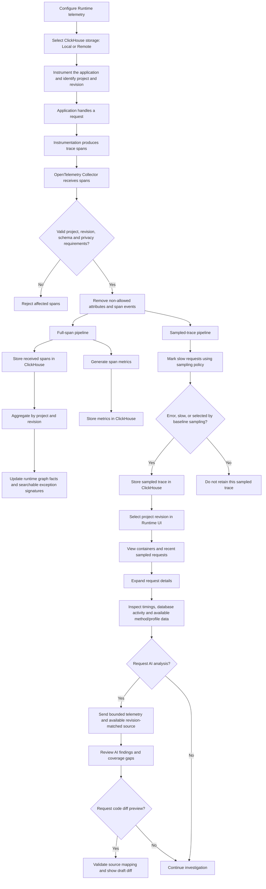

# Runtime Telemetry: Flow and Explanation

Runtime telemetry shows what an instrumented application **actually reports while it runs**. It connects request traces to a selected project revision, stores observations in ClickHouse, and presents sampled requests and optional AI analysis in the Runtime view.

## Flowchart

## 1. Configuration and identity

An administrator selects where Runtime data is stored:

- **Local:** the application starts and verifies the local ClickHouse service.
- **Remote:** the application connects to a configured remote ClickHouse server through an SSH tunnel.
- **Disabled:** collection and local ClickHouse are stopped while existing stored data is preserved.

The instrumented application must send the Developer Assistant **project ID** and immutable **revision ID** with telemetry. These identifiers allow the application to show data for the selected revision and associate observations with matching indexed source.

The collector also expects the configured telemetry schema version and a clean-code marker. Spans that fail its identity or privacy filters are dropped.

## 2. A request generates telemetry

When the instrumented application receives a request, its instrumentation can create a **trace** made up of **spans**. A trace represents a request; spans describe observed work within it, such as the server request and instrumented database operations.

Depending on configuration and runtime support, telemetry can include:

- Request route, method, status, and timing.
- Database operation and table metadata.
- Application symbol identifiers.
- PHP worker CPU-time and managed-memory estimates.
- Bounded method-hook counts and sampled Excimer profile data.

Coverage depends on the installed instrumentation and sampling. A missing observation does not prove that an operation or method did not run.

## 3. The Collector filters and divides the data

The OpenTelemetry Collector receives spans over OTLP HTTP. It applies a memory limit and privacy processing, including an allowlist of resource and span attributes. It removes span events before data enters the storage pipelines.

The accepted spans then follow two paths:

### Full-span path

Received spans are written to ClickHouse's `otel_spans_full` table. The Collector also derives span metrics and writes those to ClickHouse.

“Full” here means **all eligible spans received by this pipeline**, not necessarily all application requests. The application or SDK may already have sampled traffic before the Collector receives it.

### Sampled-trace path

The Collector applies a tail-sampling policy and retains traces that match an error or slow-request policy, plus a configurable baseline sample. The baseline defaults to **10%** of eligible traffic reaching this stage. Retained traces are stored in `otel_traces`.

Consequently, the Runtime request list is a selection of observed requests, not a complete request log.

## 4. Aggregation and source correlation

The aggregation service reads telemetry for eligible indexed project revisions. It matches observed symbol identifiers against indexed definitions, updates runtime facts in Neo4j, and stores normalized exception signatures for search.

This step makes it possible to relate runtime observations to indexed code and graph data. If a symbol cannot be matched, it is recorded as unresolved rather than assumed to belong to another revision.

## 5. Viewing a request

In the Runtime view, the user selects a project revision and sees opted-in containers and recent sampled requests. The view loads up to **50 requests**, displayed ten per page.

Expanding a request shows the available details, including request timing, database calls, method activity, and profiling information. The values have different meanings:

| Value | Meaning |
| --- | --- |
| Request or database span duration | Time observed by instrumentation. |
| PHP application time | A residual estimate after accounting for instrumented MySQL and Redis time; it can include uninstrumented work. |
| Method-hook counts | Counts for configured hooks, without a complete call sequence. |
| Excimer hotspots | Statistical profile samples, not exact method timings. |
| PHP worker CPU and memory | PHP worker estimates, not whole-container measurements. |

Auto-refresh is disabled by default; manual refresh remains available.

## 6. Optional AI analysis

The user can explicitly request analysis of an expanded request. The application assembles available telemetry and, when possible, source from the **same indexed revision**, then sends bounded context to the configured chat provider.

The UI identifies the data categories before submission. Request and response bodies, headers, credentials, raw SQL and bindings, cache keys, and exception messages are excluded. The resulting findings are **AI inferences** and are presented alongside evidence references and coverage gaps.

A user can then request a **draft diff preview** for a finding. The application checks that the source mapping matches the request's revision and returns a preview; it does not apply changes to the project. If matching source is unavailable, telemetry-only analysis can still be available, but the diff preview is withheld.

## Common reasons information is missing

- The application did not emit the span or was sampled before sending it.
- The Collector rejected a span because its project, revision, schema, or privacy requirements were not met.
- The request was not selected for sampled-trace retention or its data expired.
- Method hooks or Excimer profiling were not configured or available.
- The observed symbol could not be matched to the indexed revision.
- ClickHouse, the Collector, or the selected remote connection was unavailable.

The detailed implementation guide is [Runtime telemetry pipeline and aggregation](runtime-phase3.md).
